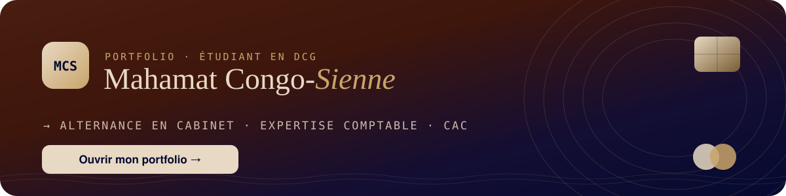

<!-- README de profil GitHub — Mahamat Congo-Sienne · à coller dans le dépôt SIANA-FI/SIANA-FI -->

  

  
   
  👆 Le logo et ce bouton ouvrent mon portfolio. Pas de pièce jointe, pas de macro, promis.

---

## 👋 Bonjour, cher recruteur

Vous êtes sur **GitHub** : c'est un peu mon **classeur de dossiers permanents**, version informatique. Rien à installer, rien à comprendre en code. Il suffit de lire, ça prend **2 minutes**, soit moins qu'un lettrage de compte 411 un lundi matin.

> **En une phrase :** je suis étudiant en **DCG**, déjà passé par trois services comptables, et je cherche une **alternance d'au moins 12 mois en cabinet d'expertise comptable ou de commissariat aux comptes**, pour mon **DCG puis mon DSCG**.

---

## 📒 Mon bilan d'ouverture

| Actif | | Passif | |
|:--|--:|:--|--:|
| Expériences en comptabilité | **3** | Dettes envers mon futur cabinet | **0 €** *(pour l'instant)* |
| Postes non soldés réduits chez Salins | **−79 %** | Provisions pour risque d'ennui | **néant** |
| Factures traitées par jour chez Altrad | **100–150** | Capitaux propres | **curiosité, rigueur** |
| Rapprochements bancaires chez EHS | **1,5 sem → 3 j** | Report à nouveau | **envie d'apprendre** |
| **Total** | **équilibré** | **Total** | **équilibré** ✅ |

*Bilan non audité. Le commissaire aux comptes, ce sera peut-être vous.*

---

## 🏛️ Pourquoi maintenant ? *(Re)fondons nos cabinets*

Au **81ᵉ Congrès de l'Ordre des experts-comptables** (Paris, septembre 2026), la profession a choisi un thème clair : **refonder le cabinet**. Quatre piliers ont été posés. Voici, très simplement, ce que j'apporte à chacun :

| Pilier du Congrès | Ce que j'apporte déjà |
|:--|:--|
| **⚖️ Réglementation** | TVA CA3, cut-off, clôtures, justification des comptes avant intervention des CAC (rattrapage de 2 exercices chez EHS). |
| **🤝 Relation client** | Cycle client complet : facturation, relances, recouvrement au quotidien avec les équipes commerciales. |
| **💡 Valeur du service** | Automatisation des tâches répétitives pour libérer du temps de conseil : rapprochements bancaires passés de 1,5 semaine à 3 jours. |
| **🎓 Compétences** | DCG en cours, DSCG ensuite, et des projets personnels en data et IA pour suivre la transformation du métier. |

Et la **facture électronique** (généralisation en septembre 2027) ? Facturation, relances et trésorerie font partie de mon quotidien depuis mes premiers postes. J'ai même construit un outil dessus (BAKLYN, plus bas).

---

## 💼 Où j'ai déjà pointé

| Période | Où | Poste | Le chiffre qui compte |
|:--|:--|:--|:--|
| 2025 – auj. | **La Compagnie des Salins** | Apprenti comptable | **−79 %** de postes non soldés · outil de recouvrement déployé dans **33 filiales** |
| 2025 | **Altrad Arnhold** | Comptable auxiliaire | **100 à 150 factures/jour** · 12 agences · TVA CA3 · clôtures mensuelles |
| 2024 – 2025 | **Association EHS** | Comptable | **13 établissements** · **2 exercices** rattrapés avant CAC · rapprochements **1,5 sem → 3 j** |

Traduction pour non-comptables : « postes non soldés » = des lignes en attente qu'il faut expliquer une par une. Moins il y en a, plus tout le monde dort bien.

---

## 🧰 Ma boîte à outils

**Logiciels comptables (ERP) :** SAP S/4HANA · Sage · Cegid Alpha · SAP Analytics Cloud · ViaReport  
**Analyse :** Excel *(mon meilleur collègue)* · Power BI · SQL · Python  
**Automatisation :** n8n · Make · Zapier *(pour que les tâches répétitives se fassent toutes seules)*

  
  
  
  
  
  
  

---

## 🚀 Mes projets (ce que je fais quand la clôture est finie)

| Projet | En une ligne | Pour un cabinet, ça veut dire… |
|:--|:--|:--|
| **[Corporate Intelligence Lab](https://github.com/SIANA-FI/Corporate-Intelligence-Lab)** | Analyse financière automatisée de sociétés (démos : Bolloré, LVMH, Air Liquide) : KPI, scoring, bénéficiaires effectifs. | Je sais lire des comptes **et** les faire parler. Utile pour l'analyse et la LCB-FT. |
| **[RatioMax](https://github.com/SIANA-FI/ratiomax-app)** | Application de révision pour étudiants en DCG, basée sur la méthode J. | J'aime apprendre, et j'aime aider les autres à apprendre. |
| **[BAKLYN](https://github.com/SIANA-FI/baklyn.2.0)** | SaaS **en ligne sur [baklyn.fr](https://baklyn.fr)** (hébergé chez Clever Cloud) pour micro-entrepreneurs : factures, provisions Urssaf et impôts, alertes de seuils de TVA. Bientôt connecté à une Plateforme Agréée pour la facture électronique. | Je comprends ce que vivent vos clients TPE, et je prépare déjà la réforme de la facture électronique. |

  

---

## ☕ FAQ du recruteur pressé

**« Il code, donc il va s'ennuyer en cabinet ? »**  
Non. Je code **pour** la comptabilité, pas à sa place. L'outil sert le jugement professionnel, il ne le remplace pas.

**« Il sait faire une clôture ? »**  
Oui : clôtures mensuelles et annuelles, cut-off, justification des comptes, rattrapage de deux exercices avant l'arrivée des CAC.

**« Il est disponible quand ? »**  
Dès que vous l'êtes. Alternance d'au moins 12 mois, DCG puis DSCG.

**« Son moment préféré de la journée ? »**  
Quand un compte d'attente tombe à zéro. Les comptables comprendront.

---

## 🎯 Ce que je cherche, clairement

<table>
<tr><td>

**Poste :** alternance comptable  
**Où :** cabinet d'**expertise comptable** ou de **commissariat aux comptes**  
**Durée :** **12 mois minimum**, idéalement sur le DCG puis le DSCG  
**Objectif :** apprendre auprès de professionnels, prendre des responsabilités sur des dossiers, et **évoluer durablement dans votre cabinet**.

</td></tr>
</table>

  
  
  

PS : si vous avez lu jusqu'ici, vous avez l'âme d'un réviseur. On devrait bien s'entendre. 🧾

